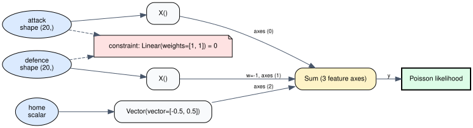

[](https://badge.fury.io/py/maxlike)
[](https://github.com/jpceia/maxlike/actions/workflows/tests.yml)

# MaxLike

**MaxLike fits statistical models with Newton's method using exact Hessians that exploit sparsity.**

In models with indexed effects (teams, players, items, states, …) almost all
second derivatives are zero: the rate of *team A vs team B* depends only on
`attack[A]` and `defence[B]`, not on the other teams. MaxLike propagates first
and second derivatives through the model *keeping that structure*: a derivative
that is diagonal in the parameter/feature axes is stored only by its diagonal.
The full dense Jacobian and Hessian of the model are never materialised.

This gives you:

- **Exact Newton steps** with quadratic convergence, instead of first-order
  methods or quasi-Newton approximations;
- **Standard errors, covariance and Fisher information for free**, since the
  Hessian is already there at the optimum;
- **Low memory and time** where general-purpose autodiff would compute dense
  Hessians column by column.

Example: the attack/defence Poisson model below, with `n` teams. The Jacobian
stored by MaxLike is compared with its dense equivalent, and the fit time with
8 Newton steps using `jax.hessian` under `jit` (one CPU, excluding JIT
compilation):

| teams | parameters | Jacobian stored | dense Jacobian | MaxLike (full fit) | JAX Newton |
|------:|-----------:|----------------:|---------------:|-------------------:|-----------:|
|    20 |         41 |              42 |         32 800 |             0.01 s |     0.24 s |
|   100 |        201 |             202 |      4 020 000 |             0.03 s |     0.39 s |
|   200 |        401 |             402 |     32 080 000 |             0.09 s |     1.61 s |
|   400 |        801 |             802 |    256 320 000 |             0.33 s |     8.98 s |

Both reach the same estimates.

## Examples

Runnable scripts in [`docs/examples`](docs/examples), on the data used by
the tests (`python docs/examples/<name>.py`):

| Example | Model | What it shows |
|---|---|---|
| [`football_goals.py`](docs/examples/football_goals.py) | Poisson, attack/defence, one row per team and match (`Take`) | team table with standard errors, expected goals of a match |
| [`football_scores.py`](docs/examples/football_scores.py) | bivariate Poisson score matrix, `Finite` likelihood | win/draw/loss, over/under and most likely score of a match, with standard errors |
| [`football_market_calibration.py`](docs/examples/football_market_calibration.py) | the score model fitted to market 1X2 probabilities (KL divergence) | prices of markets that are not in the data (goal lines, handicaps) |
| [`football_dynamic.py`](docs/examples/football_dynamic.py) | attack/defence per team and round, tied by a random walk (`RandomWalk` regularization) | strengths that change over the season, the step size chosen by forecasting, forecasts one round ahead |
| [`tennis.py`](docs/examples/tennis.py) | point → game / tie-break → set recursions | player ranking, probability of winning a set and its score distribution |
| [`race.py`](docs/examples/race.py) | `FirstOrderStatistic`: only the winner and the winning time are observed | recovering each runner's level, with and without a race-day common factor |

`tests/examples_test.py` runs them all.

Each example also has a notebook in [`docs/notebooks`](docs/notebooks), with
the theory of the model, its graph, the fit and charts that check it:
[football goals](docs/notebooks/football_goals.ipynb),
[football scores](docs/notebooks/football_scores.ipynb),
[market calibration](docs/notebooks/football_market_calibration.ipynb),
[dynamic strengths](docs/notebooks/football_dynamic.ipynb),
[tennis](docs/notebooks/tennis.ipynb) and [races](docs/notebooks/race.ipynb).

## Installation

```bash
pip install git+https://github.com/jpceia/maxlike.git
```

Requires Python 3.10+, NumPy, SciPy and pandas.

## Example: team strengths from match scores

```python
import numpy as np
import maxlike
from maxlike.func import X, Vector, Sum, Linear

# Goals scored by team i (at home or away) against team j:
#   log E[goals] = attack[i] - defence[j] + home * (h - 1/2)
n_teams = 20
rng = np.random.default_rng(0)
attack, defence = rng.normal(0, .3, (2, n_teams))
h = np.arange(2) - .5                       # 0: away, 1: home
rate = np.exp(attack[:, None, None] - defence[None, :, None] + .25 * h)

N = np.ones((n_teams, n_teams, 2))          # number of games per cell
np.einsum('iik->ik', N)[:] = 0              # a team never plays itself
goals = rng.poisson(rate) * N               # observed totals per cell

mle = maxlike.Poisson()
mle.model = Sum(3)                          # 3 feature axes: (i, j, h)
mle.model.add(X(), 0, 0)                    # param 0 (attack)  -> axis 0
mle.model.add(-X(), 1, 1)                   # param 1 (defence) -> axis 1
mle.model.add(Vector(h), 2, 2)              # param 2 (home)    -> axis 2
mle.add_constraint([0, 1], Linear([1, 1]))  # identifiability: sum = 0

mle.add_param(np.zeros(n_teams))
mle.add_param(np.zeros(n_teams))
mle.add_param(0.)

mle.fit(N=N, X=goals)

a, d, home = mle.get_params()
s_a, s_d, s_home = mle.std_error()
print("home advantage: %.3f +/- %.3f" % (home, s_home))
print("AIC: %.4f" % mle.akaike_information_criterion())
```

```
home advantage: 0.177 +/- 0.073
AIC: 2.5834
```

### Results, predictions and simulation

Parameters can carry names and labels. A pandas `Series` brings its index
as labels; otherwise pass `labels=`.

```python
mle.add_param(pd.Series(0., index=teams), name="attack")

mle.summary()                      # estimate, std error, z, p-value, 95% CI
mle.get_params(labeled=True)       # pandas objects indexed by team

# any function of the parameters, with delta-method standard errors
expected_goals = Exp() @ mle.model
value, se = mle.predict(expected_goals, se=True)

# parametric bootstrap: simulate data from the fitted model and refit
other.fit(**mle.simulate(rng=1))
```

`fit` explains models it cannot estimate. A missing constraint raises
`IdentifiabilityError` naming the flat direction, e.g. *"flat along all
of 'attack' (+1) + all of 'defence' (+1)"*; `mle.identifiability()` runs
the same check on demand. A logistic model whose data are separated (a
player who always wins) gives a warning instead of silently returning
diverging estimates. Newton steps that would decrease the objective (a
non-concave start) are damped automatically.

### Parameters that change over time

A parameter can carry a time axis, e.g. the attack of each team in each
round, gathered with `Take((team, period))`. `RandomWalk(s)` used as a
regularization ties the periods together: it adds the log density of a
Gaussian random walk with steps of size `s`, so the fit is the posterior
mode of the whole path (a smoother), still with exact Newton steps and a
sparse Hessian.

```python
model.add(Take((team, period)), 0, 0)                # attack[team, period]
mle.add_regularization([0, 1], RandomWalk(0.05))     # attack and defence
mle.add_param(np.zeros((n_teams, n_periods)), name="attack")
```

A small `s` gives back a constant parameter, a large one an independent
fit per period. The standard errors are those of the posterior given `s`.
Periods after the last observation are forecasts (the last value carried
forward). See [docs/examples/football_dynamic.py](docs/examples/football_dynamic.py),
which chooses `s` by forecasting the next round.

### Who wins, and with what value

`FirstOrderStatistic` covers observations where several participants
draw latent values, the smallest wins, and only the winner and the
winning value are observed: the fastest time in a race, the lowest bid in
an auction, the first event among competing risks. Losing participants
contribute through the probability that they drew more, so each
participant's distribution is recovered from winners only. A latent
common factor per observation (e.g. the conditions of a race day, which
slow every runner together) is integrated out. Fit it with
`maxlike.LogLikelihood`.

See [docs/first_order_statistic.md](docs/first_order_statistic.md) for
the formulas, and [docs/examples/race.py](docs/examples/race.py) for a
worked example.

### Large sparse data: one row per observation

The example above stores `N` and `goals` on the grid of all the
(team, opponent, venue) combinations, which wastes memory when most teams
never meet. `Take(index)` gathers the parameter entry of each observation
instead, `Take(index)(p) = p[index]`, so the data are plain arrays with one
entry per row of a table:

```python
import pandas as pd
from maxlike.func import Take
from maxlike.preprocessing import prepare_index

# df: one row per team and game, with columns team, opponent, at_home, goals
index, labels = prepare_index(df, {"team": ["team", "opponent"]})

mle = maxlike.Poisson()
mle.model = Sum(1)                                   # 1 feature axis: rows
mle.model.add(Take(index["team"]), 0, 0)             # attack[team]
mle.model.add(-Take(index["opponent"]), 1, 0)        # - defence[opponent]
mle.model.add(Vector(df.at_home.values - .5), 2, 0)  # home advantage
mle.add_constraint([0, 1], Linear([1, 1]))

n_teams = len(labels["team"])
mle.add_param(np.zeros(n_teams), name="attack", labels=labels["team"])
mle.add_param(np.zeros(n_teams), name="defence", labels=labels["team"])
mle.add_param(0., name="home")

mle.fit(N=np.ones(len(df)), X=df.goals.values)
```

Everything else works as before: the other likelihoods, compositions
(`Exp() @ model`, a pmf with a distribution axis), constraints,
regularization, fixed values, `summary()` and `predict()`. The same
parameter can be gathered twice, as in a Bradley–Terry model for tennis or
chess, `skill[winner] - skill[loser]`:

```python
model = Sum(1)
model.add(Take(player_1), 0, 0)
model.add(-Take(player_2), 0, 0)
```

`prepare_observations` also adds up repeated rows (the same pairing and
covariates) into counts `N` and totals, which the likelihoods accept.

The derivative of `Take` has one non-zero per observation, so the Hessian
blocks are sparse matrices with one entry per pair of effects that met.
From 500 free parameters on they are assembled into a `scipy.sparse`
Newton system (`mle.sparse_hess = True / False` forces the choice), solved
by a direct method that first eliminates the effects whose own Hessian
block is diagonal (see `maxlike.linalg`). Attack/defence model, random
schedule with 20 games per team, one CPU thread (memory: increase of the
peak resident memory during the fit):

| teams | parameters | rows    | grid: fit, memory | rows: fit, memory | rows: `std_error()` |
|------:|-----------:|--------:|------------------:|------------------:|--------------------:|
|   400 |        801 |   8 000 |     0.34 s, 42 MB |      0.08 s, 7 MB |              0.02 s |
| 1 000 |      2 001 |  20 000 |     2.3 s, 251 MB |     0.29 s, 24 MB |              0.12 s |
| 2 000 |      4 001 |  40 000 |      13 s, 775 MB |      1.0 s, 64 MB |               0.6 s |
| 5 000 |     10 001 | 100 000 |     130 s, 4.6 GB |      10 s, 275 MB |                 7 s |

When every pair of teams has met, both forms take the same time.

## How it works

A problem has three independent parts.

1. **Model `y = f(θ)`** (`maxlike.func`). It is built by composing functions:
   `Sum`, `Product`, `Compose` (`f @ g`), `X`, `Vector`, `Exp`, `Log`, the
   sigmoids, `MarkovMatrix`, copulas and so on. Each function returns its
   value, gradient and Hessian with respect to every parameter block.
   `Sum.add(f, param_map, feat_map)` says which parameters `f` uses and which
   feature axes of the output it maps to.
2. **Score `L(y)`**, the objective to maximise, given its first and second
   derivatives with respect to `y`:
   - `Poisson`, `ZeroInflatedPoisson` and `NegativeBinomial` for counts;
   - `Logistic` for binary data;
   - `Finite` and `NormalizedFinite` for arbitrary discrete distributions,
     which also minimise a Kullback–Leibler divergence when frequencies are
     replaced by probabilities.

   Maximum likelihood is the main use, but any score that is a sum over cells
   of `y` fits the same scheme.
3. **Solver** (`MaxLike.fit`). It runs a damped Newton method (or Broyden)
   with equality constraints through Lagrange multipliers, optional
   regularisation, and parameters that can be partially fixed.

### Structured tensors

The derivatives are `maxlike.Tensor` objects. Their axes are split into four
groups:

| axes    | meaning                                                |
|---------|--------------------------------------------------------|
| `x_dim` | axes of parameter *i* (1st derivative)                 |
| `y_dim` | axes of parameter *j* (2nd derivative)                 |
| `n`     | feature axes (e.g. home team, away team, venue)        |
| `dim`   | distribution axes (e.g. number of goals `0..k`)        |

`x_map` and `y_map` record that a parameter axis coincides with a feature axis,
meaning the derivative is diagonal there and only the diagonal is stored. The
chain-rule contractions (`dot_left` and `dot_right`) and the arithmetic keep
these maps. `GenericTensor` holds a lazy sum of terms with incompatible
structure instead of densifying them. `Compose` applies the full second-order
chain rule, `H = Jᵀ H_f J + Σ_k ∇f_k H_{g_k}`, on these structured objects.

### Model graphs

`mle.graph()` (or `func.graph()` for a model on its own) builds the
computation graph of a problem. It shows the parameters, the functions they
flow through (with weights and the feature axes each term maps to), the
likelihood, the constraints and the regularizations.

```python
g = mle.graph(["attack", "defence", "home"])
print(g.to_mermaid())        # Mermaid text, rendered natively by GitHub
print(g.to_dot())            # Graphviz DOT text
g.render("model.svg")        # image; needs Graphviz
```

To render images and show graphs inline in Jupyter, install Graphviz
and the optional extra: `pip install "maxlike[graph]"`.

The graph of the example above:



The notebooks in [`docs/notebooks`](docs/notebooks) show the graphs of the
other examples.

## Limitations

- CPU only (NumPy); no GPU support.
- For grid models the final Newton system over the free parameters is
  dense, so they suit problems up to a few thousand parameters.
- For observation-indexed models the Newton system is sparse, and its cost
  is that of factorising what is left after eliminating one set of effects
  (`maxlike.linalg`): small for students × questions data, but a dense
  matrix of half the size when two equally large sets of effects meet at
  random (5 000 teams: 0.3 GB), and above 20 000 rows a sparse LU that is
  slow for such data. A model with a single set of effects (Bradley–Terry)
  has nothing to eliminate: with random pairings it is solved as a dense
  matrix (10 000 players: 17 s on 4 threads, 1.7 GB with `std_error()`),
  with structured ones (leagues, regions, neighbours in rank) by a sparse
  LU.
- `error_matrix()` and `fisher_matrix()` are dense, (number of
  parameters)²; `std_error()` computes only the diagonal.
- `fit(method="broyden")` keeps a dense inverse Hessian, so it is meant
  for moderate numbers of parameters.
- With SciPy older than 1.8 the sparse Newton system is always factorised
  dense (up to 20 000 rows): SciPy 1.7's SuperLU crashed intermittently in
  our CI. Large sparse problems are faster with a recent SciPy.
- The built-in scores assume the objective is a sum over the cells of `y`
  (`Finite` additionally normalises along the distribution axes).

## Development

```bash
pip install -e ".[test]"
pytest
```

## License

Copyright (C) joao ceia.

MaxLike is free software: you can redistribute it and/or modify it under the
terms of the GNU General Public License as published by the Free Software
Foundation, either version 3 of the License, or (at your option) any later
version. See [LICENSE](LICENSE).
